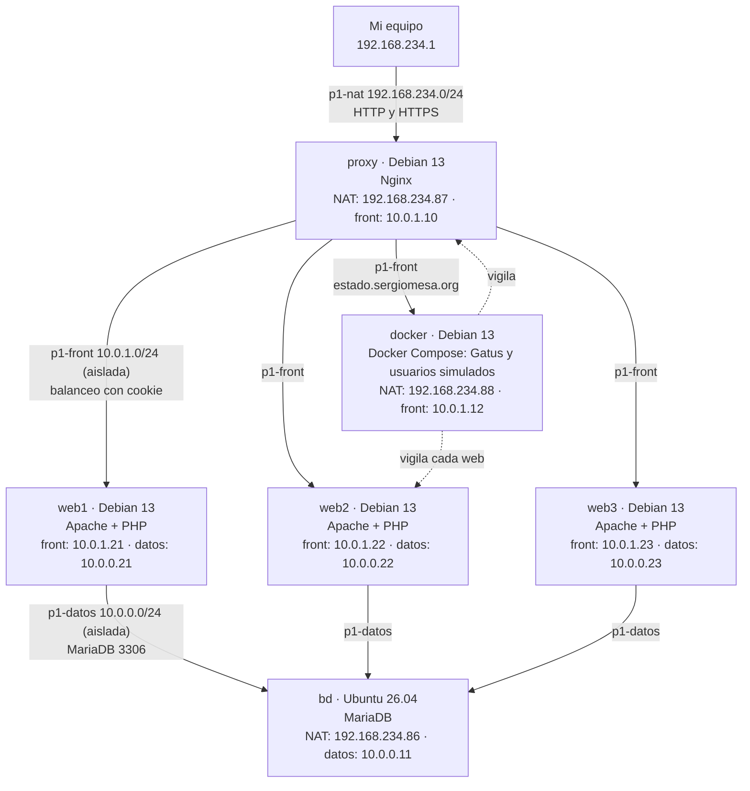

# Proyecto 1: Infraestructura como código

Escenario creado con Terraform sobre libvirt y configurado con Ansible
para poner en producción **guestbook_php**, un libro de visitas en PHP con MariaDB,
detrás de un proxy inverso Nginx con HTTPS. La aplicación corre en **tres servidores web**
con balanceo de carga, sesiones persistentes y actualización sin cortes. Un panel de estado
(**Gatus**), desplegado con Docker Compose, vigila el escenario.

## Esquema del escenario



| Máquina | Sistema | Red NAT (`p1-nat`) | Red `p1-front` | Red `p1-datos` | Servicio |
|---|---|---|---|---|---|
| proxy | Debian 13 | 192.168.234.87 (DHCP) | 10.0.1.10 | - | Nginx |
| web1 | Debian 13 | 192.168.234.102 (DHCP) | 10.0.1.21 | 10.0.0.21 | Apache + PHP |
| web2 | Debian 13 | 192.168.234.103 (DHCP) | 10.0.1.22 | 10.0.0.22 | Apache + PHP |
| web3 | Debian 13 | 192.168.234.104 (DHCP) | 10.0.1.23 | 10.0.0.23 | Apache + PHP |
| docker | Debian 13 | 192.168.234.88 (DHCP) | 10.0.1.12 | - | Docker Compose: Gatus y usuarios simulados |
| bd | Ubuntu 26.04 | 192.168.234.86 (DHCP) | - | 10.0.0.11 | MariaDB |

- **p1-nat**: red NAT con DHCP. Mi equipo llega al proxy (HTTP y HTTPS) y Ansible entra por
  SSH a todas las máquinas. Las máquinas salen a internet por ella. Las MAC son fijas, así que
  el DHCP les asigna normalmente las mismas IP (la salida de `terraform output` muestra las actuales).
- **p1-front**: red muy aislada, sin DHCP ni IP en el anfitrión. La usan el proxy, las tres webs y docker.
- **p1-datos**: red muy aislada, sin DHCP ni IP en el anfitrión. Solo la usan las webs y bd.
- El proxy es la única entrada: Apache escucha solo en la IP de `p1-front`, Gatus solo publica
  su puerto en la IP de `p1-front` y MariaDB solo escucha en la de `p1-datos`.

## Aplicaciones

| Nombre | Qué es | Dónde se ejecuta |
|---|---|---|
| `https://www.sergiomesa.org` | La guestbook | Apache en web1, web2 y web3, con MariaDB en bd |
| `https://estado.sergiomesa.org` | Panel de estado (Gatus) | Contenedor en docker, con Docker Compose |

Gatus comprueba cada 30 segundos que la guestbook responde por HTTPS, que la base de datos
funciona (a través de la API de la aplicación), que HTTP redirige a HTTPS, que el puerto 443
del proxy responde, que Apache responde en cada una de las webs y que el certificado no va a caducar.

## Alta disponibilidad de la web

- **Balanceo de carga**: el `upstream` de Nginx tiene las tres webs, generadas con un bucle
  a partir del inventario. Cada web añade las cabeceras `X-Servidor` (su nombre) y
  `X-Version` (la versión desplegada), para ver quién responde.
- **Sesiones persistentes**: la primera vez que entra un usuario, el proxy le da la cookie
  `usuario_web` con un identificador aleatorio, y con `hash ... consistent` lo manda siempre
  a la misma web.
- **Si una web falla**, Nginx repite la petición en otra (`proxy_next_upstream`) y la deja
  fuera 10 segundos (`max_fails` y `fail_timeout`). El usuario no ve el error.
- **Si fallan todas**, el proxy responde un 503 con una página de mantenimiento propia, que
  está en el propio proxy y no se puede pedir directamente (`internal`).

### Actualizar sin cortes

Cambio `web_version` en `ansible/group_vars/servidores_web.yaml` y lanzo:

```bash
cd ansible && ansible-playbook actualizar.yaml
```

Va web a web (`serial: 1`): la saca del balanceo con `down`, espera a que terminen sus
peticiones, la actualiza con el rol `web`, comprueba desde el proxy que responde con la
versión nueva y la vuelve a meter. Si una web falla, se para todo (`max_fail_percentage: 0`).

### Usuarios simulados

En la máquina docker hay 4 contenedores (`usuario1` a `usuario4`) que entran en la web cada
segundo, cada uno con su cookie, y escriben en su log la web y la versión que han visto. Van
en el perfil `simulacion` de Compose, así que solo arrancan cuando se piden:

```bash
ssh sergio@192.168.234.88
cd /opt/estado
sudo docker compose --profile simulacion up -d
sudo docker compose --profile simulacion logs -f usuario1 usuario2 usuario3 usuario4
sudo docker compose --profile simulacion stop
```

## Requisitos previos

- libvirt/KVM, Terraform, `openssl`, y Ansible con las colecciones
  `community.mysql` y `community.docker`.
- Clave SSH en `~/.ssh/id_rsa` (la pública se inyecta con cloud-init).
- Imágenes base en el pool `default` de libvirt (los discos de las máquinas son
  clones ligeros de ellas):

  ```bash
  cd /var/lib/libvirt/images
  sudo wget -O debian13-base.qcow2 https://cloud.debian.org/images/cloud/trixie/latest/debian-13-generic-amd64.qcow2
  sudo wget -O ubuntu2604-base.qcow2 https://cloud-images.ubuntu.com/resolute/current/resolute-server-cloudimg-amd64.img
  virsh -c qemu:///system pool-refresh default
  ```

## Despliegue

```bash
cd opentofu && terraform init && terraform apply
cd ../ansible && ansible-playbook site.yaml
```

`terraform apply` crea las redes, los discos y las máquinas, y genera el inventario
`ansible/inventario.ini` a partir de sus IP. `site.yaml` aplica los roles
`commons`, `bd`, `web`, `proxy`, `docker` y `estado`.

Para acceder por nombre, añado la IP del proxy en la red NAT (la muestra `terraform output`)
al `/etc/hosts` de mi equipo, con los dos nombres:

```
192.168.234.87 www.sergiomesa.org estado.sergiomesa.org
```

### Certificado

El rol `proxy` crea con `openssl` una CA propia y un certificado para el proxy firmado por ella,
con los dos nombres. Se guardan en `ansible/pki/`, que no se sube al repositorio. La primera
ejecución del playbook los genera, y las siguientes los reutilizan; el certificado se vuelve a
firmar solo si cambian sus nombres. Así la CA se mantiene aunque destruya y recree las máquinas.

Para que el navegador se fíe, importo `ansible/pki/ca.crt` como autoridad certificadora. Con `curl`:

```bash
curl --cacert ansible/pki/ca.crt https://www.sergiomesa.org/
```

## Comprobaciones

```bash
cd ansible && ansible-playbook comprobaciones.yaml
```

Las comprobaciones cubren la entrega inicial y las modificaciones 1 y 2: comprueba que HTTP redirige a HTTPS, que el certificado solo es de confianza con la CA propia,
que el proxy envía HSTS y cachea los estáticos, que limita las peticiones a `/nuevo` con un 429,
que Apache registra la IP real del cliente, que web se conecta a la base de datos, que se rechazan
las conexiones desde cualquier otro sitio, que el panel de estado responde por HTTPS con todo en
verde y que web, bd y docker no son accesibles directamente desde mi equipo.

## Decisiones de diseño

- **Idempotencia del esquema**: `schema.sql` no usa `IF NOT EXISTS`, así que antes
  de importarlo se consulta `information_schema` y solo se carga si la tabla no existe.
- **Versión fijada de la aplicación**: los ficheros se descargan de un commit concreto
  del repositorio de guestbook_php, para que el despliegue sea siempre el mismo.
- **Mínimo privilegio**: el usuario de la aplicación solo tiene `SELECT`, `INSERT`,
  `UPDATE` y `DELETE`, y existe una vez por cada servidor web del grupo. Pasar de una web
  a tres no necesitó cambiar el rol `bd`, porque ya recorría todas las webs del grupo.
- **Tarjetas de red genéricas**: cada máquina define una lista de redes en `opentofu/locals.tf`
  y las tarjetas, el cloud-init, el output y el inventario se generan a partir de ella. Añadir
  la máquina docker fue añadir una entrada.
- **CA fuera del repositorio**: las claves privadas nunca se suben, y la CA declara `keyUsage`
  porque los clientes que verifican en modo estricto (como Python 3.13) lo exigen.
- **IP real del cliente**: Nginx envía `X-Forwarded-For` y Apache lo lee con `mod_remoteip`,
  pero solo si la petición viene del proxy (`RemoteIPInternalProxy`).
- **Caché solo de estáticos**, **HSTS con `max-age` corto** (300 s) mientras se prueba y
  **límite de peticiones en el proxy**, antes de que la petición llegue a Apache.
- **Gatus en lugar de Uptime Kuma**: Gatus se configura con un fichero YAML, que Ansible genera
  con una plantilla. Así la configuración del panel sale del repositorio y vuelve a estar lista
  tras un destroy y un apply, sin configurar nada a mano.
- **Contenedor con versión fijada y reinicio automático**: la imagen es `twinproduction/gatus`
  con una versión concreta, con `restart: unless-stopped`. Gatus confía en la CA propia gracias
  a `SSL_CERT_FILE`, y resuelve el nombre de la guestbook hacia el proxy con `extra_hosts`.
- **Cookie y no IP para las sesiones persistentes**: con `ip_hash`, todos los usuarios que
  llegan con la misma IP (una misma red, o los contenedores de una misma máquina) irían a la
  misma web. Con la cookie, cada navegador es un usuario distinto. Además, cada web guarda sus
  propias sesiones de PHP, así que un usuario no debe ir saltando de una web a otra.
- **`down` en vez de quitar la web del `upstream`**: con `hash consistent`, al marcar una web
  como `down` solo se mueven sus usuarios, y vuelven a ella cuando sale del mantenimiento.
- **Usuarios simulados en un perfil de Compose**: así no arrancan con Gatus y no llenan los
  logs del proxy con peticiones cuando no estoy haciendo pruebas.

## Estructura del repositorio

```
opentofu/
  providers.tf         Proveedores libvirt y local
  variables.tf         Imágenes base, memoria, redes, usuario y clave SSH
  locals.tf            Definición de las máquinas, sus redes y su grupo de Ansible
  redes.tf             Redes p1-nat, p1-datos y p1-front
  volumenes.tf         Discos como clones ligeros de la imagen base
  cloudinit.tf         Usuario, clave SSH e IP estática con cloud-init
  maquinas.tf          Máquinas virtuales (una tarjeta por cada red)
  salidas.tf           Output de IP e inventario de Ansible
  plantillas/          Plantilla del inventario
  cloud-init/          Plantillas de cloud-init
ansible/
  ansible.cfg          Configuración de Ansible
  site.yaml            Playbook principal
  actualizar.yaml      Actualización de las webs de una en una, sin cortes
  comprobaciones.yaml  Comprobaciones del escenario
  group_vars/          Variables (nombres, IP, usuarios, contraseñas)
  roles/commons        Actualización del sistema y paquetes comunes
  roles/bd             MariaDB, base de datos, usuario y tablas
  roles/web            Apache, PHP, virtual host, aplicación, mod_remoteip y cabeceras X-Servidor y X-Version
  roles/proxy          CA propia, certificado y Nginx (HTTPS, caché, límite de peticiones, balanceo con
                       sesiones persistentes, página de mantenimiento y los dos sitios)
  roles/docker         Docker y Docker Compose
  roles/estado         Gatus y los usuarios simulados con Docker Compose: compose.yaml, configuración
                       y script generados con plantillas
```
