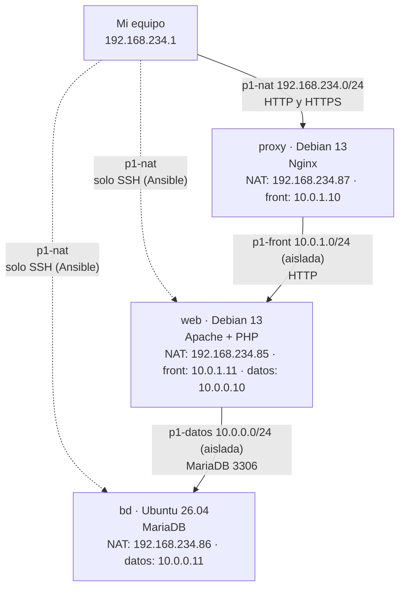

# Proyecto 1: Infraestructura como código

Escenario creado con Terraform/OpenTofu sobre libvirt y configurado con Ansible
para poner en producción **guestbook_php**, un libro de visitas en PHP con MariaDB,
detrás de un proxy inverso Nginx con HTTPS.

## Esquema del escenario



| Máquina | Sistema | Red NAT (`p1-nat`) | Red `p1-front` | Red `p1-datos` | Servicio |
|---|---|---|---|---|---|
| proxy | Debian 13 | 192.168.234.87 (DHCP) | 10.0.1.10 | - | Nginx |
| web | Debian 13 | 192.168.234.85 (DHCP) | 10.0.1.11 | 10.0.0.10 | Apache + PHP |
| bd | Ubuntu 26.04 | 192.168.234.86 (DHCP) | - | 10.0.0.11 | MariaDB |

- **p1-nat**: red NAT con DHCP. Mi equipo llega al proxy (HTTP y HTTPS) y Ansible entra por
  SSH a las tres máquinas. Las máquinas salen a internet por ella. Las MAC son fijas, así que
  el DHCP les asigna normalmente las mismas IP (la salida de `terraform output` muestra las actuales).
- **p1-front**: red muy aislada, sin DHCP ni IP en el anfitrión. Solo la usan el proxy y web.
- **p1-datos**: red muy aislada, sin DHCP ni IP en el anfitrión. Solo la usan web y bd.
- Apache escucha solo en la IP de `p1-front` y MariaDB solo en la de `p1-datos`: web no responde
  directamente a mi equipo, y bd no es accesible desde fuera.

## Requisitos previos

- libvirt/KVM, Terraform u OpenTofu, `openssl`, y Ansible con las colecciones `community.mysql`.
- Clave SSH en `~/.ssh/id_rsa` (la pública se inyecta con cloud-init).
- Imágenes base en el pool `default` de libvirt (los discos de las máquinas son
  clones ligeros de ellas):

  ```bash
  cd /var/lib/libvirt/images
  sudo wget -O debian13-base.qcow2 https://cloud.debian.org/images/cloud/trixie/latest/debian-13-generic-amd64.qcow2
  sudo wget -O ubuntu2604-base.qcow2 https://cloud-images.ubuntu.com/resolute/current/resolute-server-cloudimg-amd64.img
  virsh -c qemu:///system pool-refresh default
  ```

## Despliegue

```bash
cd opentofu && tofu init && tofu apply        # o terraform init && terraform apply
cd ../ansible && ansible-playbook site.yaml
```

`tofu apply` crea las redes, los discos y las máquinas, y genera el inventario
`ansible/inventario.ini` a partir de sus IP. `site.yaml` aplica los roles
`commons`, `bd`, `web` y `proxy`.

Para acceder a la aplicación por su nombre, añado la IP del proxy en la red NAT (la muestra
`tofu output`) al `/etc/hosts` de mi equipo:

```
192.168.234.87 www.sergiomesa.org
```

### Certificado

El rol `proxy` crea con `openssl` una CA propia y un certificado para el proxy firmado por ella.
Se guardan en `ansible/pki/`, que no se sube al repositorio. La primera ejecución del playbook los
genera, y las siguientes los reutilizan, así que la CA se mantiene aunque destruya y recree las máquinas.

Para que el navegador se fíe, importo `ansible/pki/ca.crt` como autoridad certificadora. Con `curl`:

```bash
curl --cacert ansible/pki/ca.crt https://www.sergiomesa.org/
```

## Comprobaciones

```bash
cd ansible && ansible-playbook comprobaciones.yaml
```

Comprueba que HTTP redirige a HTTPS, que el certificado solo es de confianza con la CA propia,
que el proxy envía HSTS y cachea los estáticos, que limita las peticiones a `/nuevo` con un 429,
que Apache registra la IP real del cliente, que web se conecta a la base de datos, que se rechazan
las conexiones desde cualquier otro sitio y que web y bd no son accesibles directamente desde mi equipo.

## Decisiones de diseño

- **Idempotencia del esquema**: `schema.sql` no usa `IF NOT EXISTS`, así que antes
  de importarlo se consulta `information_schema` y solo se carga si la tabla existe.
- **Versión fijada de la aplicación**: los ficheros se descargan de un commit concreto
  del repositorio de guestbook_php, para que el despliegue sea siempre el mismo.
- **Mínimo privilegio**: el usuario de la aplicación solo tiene `SELECT`, `INSERT`,
  `UPDATE` y `DELETE`, y existe una vez por cada servidor web del grupo.
- **Tarjetas de red genéricas**: cada máquina define una lista de redes en `opentofu/locals.tf`
  y las tarjetas, el cloud-init, el output y el inventario se generan a partir de ella.
- **CA fuera del repositorio**: las claves privadas nunca se suben. Las tareas de `openssl` solo
  se ejecutan si su fichero no existe, y la CA declara `keyUsage` porque los clientes que verifican
  en modo estricto (como Python 3.13) lo exigen.
- **IP real del cliente**: Nginx envía `X-Forwarded-For` y Apache lo lee con `mod_remoteip`,
  pero solo si la petición viene del proxy (`RemoteIPInternalProxy`). Un cliente que falsee la
  cabecera no consigue falsear su IP en los logs.
- **Caché solo de estáticos**: las páginas de la aplicación llevan sesión y no se cachean.
- **HSTS con `max-age` corto** (300 s) mientras se prueba, para no quedar atrapado en HTTPS si falla el certificado.
- **Límite de peticiones en el proxy**: actúa antes que el de la propia aplicación, y las peticiones
  rechazadas no llegan a Apache.

## Estructura del repositorio

```
opentofu/
  providers.tf         Proveedores libvirt y local
  variables.tf         Imágenes base, memoria, redes, usuario y clave SSH
  locals.tf            Definición de las máquinas, sus redes y su grupo de Ansible
  redes.tf             Redes p1-nat, p1-datos y p1-front
  volumenes.tf         Discos como clones ligeros de la imagen base
  cloudinit.tf         Usuario, clave SSH e IP estática con cloud-init
  maquinas.tf          Máquinas virtuales (una tarjeta por cada red)
  salidas.tf           Output de IP e inventario de Ansible
  plantillas/          Plantilla del inventario
  cloud-init/          Plantillas de cloud-init
ansible/
  ansible.cfg          Configuración de Ansible
  site.yaml            Playbook principal
  comprobaciones.yaml  Comprobaciones del escenario
  group_vars/          Variables (nombres, IP, usuarios, contraseñas)
  roles/commons        Actualización del sistema y paquetes comunes
  roles/bd             MariaDB, base de datos, usuario y tablas
  roles/web            Apache, PHP, virtual host, aplicación y mod_remoteip
  roles/proxy          CA propia, certificado y Nginx (HTTPS, caché y límite de peticiones)
```
