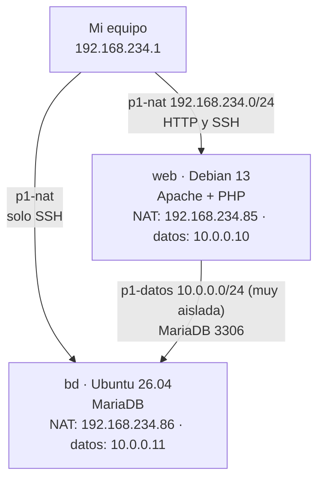

# Proyecto 1: Infraestructura como código

Escenario creado con Terraform/OpenTofu sobre libvirt y configurado con Ansible
para poner en producción **guestbook_php**, un libro de visitas en PHP con MariaDB.

## Esquema del escenario



| Máquina | Sistema | Red NAT (`p1-nat`) | Red de datos (`p1-datos`) | Servicio |
|---|---|---|---|---|
| web | Debian 13 | 192.168.234.85 (DHCP) | 10.0.0.10 | Apache + PHP |
| bd | Ubuntu 26.04 | 192.168.234.86 (DHCP) | 10.0.0.11 | MariaDB |

- **p1-nat**: red NAT con DHCP. Acceso desde mi equipo y salida a internet. Las MAC
  son fijas, así que el DHCP asigna siempre las mismas IP.
- **p1-datos**: red muy aislada, sin DHCP ni IP en el anfitrión. Solo la usan web y bd.
- MariaDB escucha solo en `10.0.0.11`, y el usuario de la aplicación solo puede
  conectarse desde la IP de web en la red de datos.

## Requisitos previos

- libvirt/KVM, Terraform u OpenTofu, y Ansible con la colección `community.mysql`.
- Clave SSH en `~/.ssh/id_rsa` (la pública se inyecta con cloud-init).
- Imágenes base en el pool `default` de libvirt (los discos de las máquinas son
  clones ligeros de ellas):

  ```bash
  cd /var/lib/libvirt/images
  sudo wget -O debian13-base.qcow2 https://cloud.debian.org/images/cloud/trixie/latest/debian-13-generic-amd64.qcow2
  sudo wget -O ubuntu2604-base.qcow2 https://cloud-images.ubuntu.com/resolute/current/resolute-server-cloudimg-amd64.img
  virsh -c qemu:///system pool-refresh default
  ```

## Despliegue

```bash
cd opentofu && tofu init && tofu apply        # o terraform init && terraform apply
cd ../ansible && ansible-playbook site.yaml
```

`tofu apply` crea las redes, los discos y las máquinas, y genera el inventario
`ansible/inventario.ini` a partir de sus IP. `site.yaml` aplica los roles
`commons`, `bd` y `web`.

Para acceder a la aplicación por su nombre, añade la IP de web (la muestra
`tofu output`) al `/etc/hosts` de tu equipo:

```
192.168.234.85 www.sergiomesa.org
```

## Comprobaciones

```bash
cd ansible && ansible-playbook comprobaciones.yaml
```

Comprueba que la aplicación responde por su nombre, que web se conecta a la base
de datos y que se rechazan las conexiones desde cualquier otro sitio.

## Decisiones de diseño

- **Idempotencia del esquema**: `schema.sql` no usa `IF NOT EXISTS`, así que antes
  de importarlo se consulta `information_schema` y solo se carga si la tabla no existe.
- **Versión fijada de la aplicación**: los ficheros se descargan de un commit concreto
  del repositorio de guestbook_php, para que el despliegue sea siempre el mismo.
- **Mínimo privilegio**: el usuario de la aplicación solo tiene `SELECT`, `INSERT`,
  `UPDATE` y `DELETE`, y existe una vez por cada servidor web del grupo.
- **Escalable**: las máquinas se definen en `opentofu/locals.tf`; añadir una nueva
  la incluye automáticamente en su grupo del inventario.

## Estructura del repositorio

```
opentofu/
  providers.tf         Proveedores libvirt y local
  variables.tf         Imágenes base, memoria, redes, usuario y clave SSH
  locals.tf            Definición de las máquinas y su grupo de Ansible
  redes.tf             Red NAT y red de datos
  volumenes.tf         Discos como clones ligeros de la imagen base
  cloudinit.tf         Usuario, clave SSH e IP estática con cloud-init
  maquinas.tf          Máquinas virtuales
  salidas.tf           Output de IP e inventario de Ansible
  plantillas/          Plantilla del inventario
  cloud-init/          Plantillas de cloud-init
ansible/
  ansible.cfg          Configuración de Ansible
  site.yaml            Playbook principal
  comprobaciones.yaml  Comprobaciones del escenario
  group_vars/          Variables (nombres, IP, usuarios, contraseñas)
  roles/commons        Actualización del sistema y paquetes comunes
  roles/bd             MariaDB, base de datos, usuario y tablas
  roles/web            Apache, PHP, virtual host y aplicación
```
